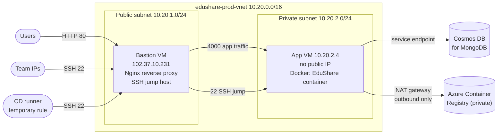
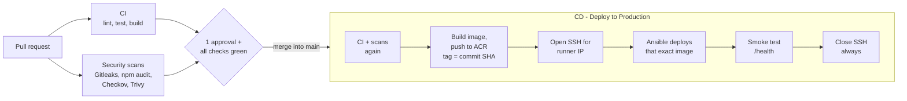

# EduShare Platform

**Sharing Knowledge, Empowering African Students**

EduShare is a web platform where students and teachers find, share and rate affordable learning resources. This README is the **operations manual** for the production system: how it is built, how it is deployed, how to run it, and what to do when something breaks.

| | |
|---|---|
| **Live site** | http://102.37.10.231 |
| **Health check** | http://102.37.10.231/health → `{"status":"ok"}` |
| **Cloud** | Microsoft Azure, South Africa North, resource group `edushare-summative-rg` |
| **Deploys** | Automatically on every merge into `main` ([CD workflow](.github/workflows/cd.yml)) |
| **Release history** | [CHANGELOG.md](CHANGELOG.md) |

---

## Contents

1. [Architecture](#1-architecture)
2. [Delivery pipeline](#2-delivery-pipeline)
3. [Repository layout](#3-repository-layout)
4. [Setting up the environment from scratch](#4-setting-up-the-environment-from-scratch)
5. [Day-to-day operations](#5-day-to-day-operations)
6. [Observability](#6-observability)
7. [Security](#7-security)
8. [Troubleshooting](#8-troubleshooting)
9. [Local development](#9-local-development)
10. [API reference](#10-api-reference)
11. [Team](#11-team)
12. [AI Use Annex](#12-ai-use-annex)

---

## 1. Architecture



**How a request flows:** a user opens `http://102.37.10.231` → Nginx on the bastion forwards it to the app container on the private VM (port 4000) → the Express API serves the React frontend and reads data from Cosmos DB.

| Component | Azure resource | Purpose |
|-----------|----------------|---------|
| Network | `edushare-prod-vnet` with a public and a private subnet | Isolates the app VM from the internet |
| Bastion VM | `edushare-prod-bastion-vm` (Ubuntu 24.04, `Standard_B2ats_v2`) | The only machine with a public IP. Nginx reverse proxy for the website and SSH jump host |
| App VM | `edushare-prod-app-vm` (Ubuntu 24.04, `Standard_B2als_v2`) | Runs the app container. No public IP |
| Firewalls | `edushare-prod-public-nsg`, `edushare-prod-private-nsg` + UFW on each VM | Public: 22 from team IPs, 80 from anyone. Private: 22 and 4000 from the bastion subnet only |
| NAT gateway | `edushare-prod-natgw` | Outbound internet for the app VM (packages, image pulls), nothing inbound |
| Database | `edushare-prod-cosmos-gvv9o` (Cosmos DB for MongoDB, free tier) | Managed database, reachable only from the private subnet |
| Registry | `edushareacrgvv9o.azurecr.io` (ACR Basic) | Private registry for the app image |
| Terraform state | Storage account `edusharetfstate29373`, container `tfstate` | Shared remote state for the team and the pipeline |

Everything above is created by Terraform ([`terraform/`](terraform/README.md)) and configured by Ansible ([`ansible/`](ansible/README.md)). Design decisions and accepted risks are explained in each folder's README.

---

## 2. Delivery pipeline



### Workflows

| Workflow | Runs on | Jobs | Fails when |
|----------|---------|------|------------|
| [CI](.github/workflows/ci.yml) | Push to any branch except `main`, PRs into `main`/`summative`, called by CD | Backend (lint and test), Frontend (lint and build), Docker build | Lint error, failing test, build error |
| [Security](.github/workflows/security.yml) | PRs into `main`/`summative`, called by CD | Secret scan (Gitleaks), Dependency scan (npm audit), IaC scan (Checkov), Image scan (Trivy) | Any secret; HIGH/CRITICAL dependency issue; any failed Checkov check; fixable HIGH/CRITICAL image vulnerability |
| [CD](.github/workflows/cd.yml) | Push to `main` (a merged PR) or manually | CI checks → Security scans → Build and push image to ACR → Deploy with Ansible | Any earlier stage fails; Ansible cannot deploy; `/health` does not answer |

Key properties of the CD pipeline:

- **Nothing deploys without passing the same checks as a pull request**: CD calls the CI and Security workflows first.
- **Every release is traceable**: the image is tagged with the commit SHA (`edushareacrgvv9o.azurecr.io/edushare:<sha>`), and Ansible deploys that exact tag.
- **SSH is never left open**: the runner's IP gets a temporary NSG rule (`cd-runner-<run id>`) that the last step deletes even if the deploy fails.
- **One deploy at a time**: `concurrency: production-deploy` queues overlapping runs.
- **Least privilege**: the pipeline's Azure identity is a service principal that is Contributor on `edushare-summative-rg` only.

### Branch protection on `main`

- Changes reach `main` only through a pull request with **at least one approval**; approvals are dismissed when new commits are pushed
- All seven checks above must pass, and the branch must be up to date with `main`
- Conversations must be resolved before merging
- Nobody can bypass the rules, administrators included; force pushes and branch deletion are blocked

---

## 3. Repository layout

```
EduShare-Platform-/
├── .github/workflows/
│   ├── ci.yml              # lint, test, build, Docker build
│   ├── security.yml        # Gitleaks, npm audit, Checkov, Trivy
│   └── cd.yml              # build → push to ACR → Ansible deploy → smoke test
├── terraform/              # Azure infrastructure (modules: network, compute, database, registry)
├── ansible/                # Server configuration and app deployment (roles: common, docker, security, proxy, app)
├── backend/                # Express API, Mongoose models, Jest tests
├── frontend/               # React + TypeScript (Vite)
├── docs/                   # Evidence screenshots
├── Dockerfile              # Multi-stage build: React build, then Node runtime as non-root
├── docker-compose.yml      # Local development: app + MongoDB
├── CHANGELOG.md            # What changed in each phase (F1 → F2 → F3 → Summative)
├── SECURITY.md             # Scan findings and how they were handled
└── README.md               # This operations manual
```

| Layer | Technology |
|-------|------------|
| Frontend | React, TypeScript, Vite, React Router |
| Backend | Node.js 22, Express, Mongoose |
| Database | Azure Cosmos DB for MongoDB (production), MongoDB 7 in Docker (local) |
| Testing | Jest, Supertest, mongodb-memory-server |
| Infrastructure as Code | Terraform (azurerm ~> 4.0) |
| Configuration management | Ansible, Ansible Vault |
| CI/CD | GitHub Actions, Azure Container Registry |
| Security scanning | Gitleaks, npm audit, Checkov, Trivy |

---

## 4. Setting up the environment from scratch

Follow these steps in order to rebuild production in an empty Azure subscription.

### Prerequisites

- Azure CLI, Terraform ≥ 1.6, Ansible (`ansible-core`), Git
- An SSH key pair (the team uses `~/.ssh/alu-devops`)
- Owner rights on an Azure subscription (step 1 only)

### Step 1: Azure one-time setup (subscription owner)

Create the resource group, a service principal limited to it, the Terraform state storage, and register the providers. The full commands are in [terraform/README.md → One-time setup](terraform/README.md#one-time-setup-subscription-owner).

### Step 2: Create the infrastructure (Terraform)

```bash
export ARM_CLIENT_ID=<appId> ARM_CLIENT_SECRET=<password> \
       ARM_TENANT_ID=<tenant> ARM_SUBSCRIPTION_ID=<subscription id>

cd terraform
cp terraform.tfvars.example terraform.tfvars   # add team IPs (/32) and public keys, incl. keys/cd-deploy.pub
terraform init -backend-config=backend.hcl
terraform plan -out=tfplan
terraform apply tfplan
terraform output                               # IPs, registry, NSG name, SSH commands
```

### Step 3: Configure the servers and deploy (Ansible)

```bash
cd ansible
ansible-galaxy collection install -r requirements.yml
cp group_vars/all/vault.yml.example group_vars/all/vault.yml
#   paste: terraform output -raw mongodb_connection_string
#          terraform output -raw acr_admin_password
ansible-vault encrypt group_vars/all/vault.yml
ansible edushare -m ping --ask-vault-pass
ansible-playbook playbook.yml --ask-vault-pass
```

If the Terraform outputs changed (new IPs or registry name), update `ansible/inventory/hosts.ini`, `ansible/group_vars/all/vars.yml` and the `env:` block of `.github/workflows/cd.yml` first.

### Step 4: Connect the pipeline (GitHub repository secrets)

**Settings → Secrets and variables → Actions → New repository secret**

| Secret | Value |
|--------|-------|
| `AZURE_CLIENT_ID` | Service principal `appId` |
| `AZURE_CLIENT_SECRET` | Service principal password |
| `AZURE_SUBSCRIPTION_ID` | Subscription ID |
| `AZURE_TENANT_ID` | Tenant ID |
| `SSH_PRIVATE_KEY` | The full private deploy key, **including** the `-----BEGIN…` and `-----END…` lines. Its public half is `terraform/keys/cd-deploy.pub` |
| `ANSIBLE_VAULT_PASSWORD` | The password used to encrypt `vault.yml` |

### Step 5: Protect `main`

**Settings → Branches → Add classic branch protection rule** with the settings listed in [Branch protection](#branch-protection-on-main). The status checks can only be selected after they have run once.

### Tear down

```bash
cd terraform && terraform destroy
```

The resource group and the state storage account remain, because they are created outside this configuration.

---

## 5. Day-to-day operations

### Ship a change

```bash
git checkout main && git pull
git checkout -b <short-description>
# ...edit, commit...
git push -u origin <short-description>
```

Open a pull request into `main`, wait for the seven checks, get one approval and merge. CD deploys automatically; follow it in **Actions → CD - Deploy to Production**. A full run takes about 5–10 minutes.

### Redeploy or roll back

| Situation | What to do |
|-----------|------------|
| Redeploy the current `main` | **Actions → CD - Deploy to Production → Run workflow** |
| Roll back a bad release (preferred) | Revert the pull request on GitHub and merge the revert; CD deploys the previous code |
| Roll back immediately to a known-good build | `cd ansible && ansible-playbook playbook.yml --ask-vault-pass --tags app,verify -e app_image_tag=<old commit SHA>` (every SHA-tagged image stays in ACR) |

### Give a teammate SSH access

1. Add their IP (`curl -4 -s ifconfig.me`, as `x.x.x.x/32`) to `allowed_ssh_cidrs` and their public key to `ssh_public_key_paths` in `terraform.tfvars`
2. `terraform plan -out=tfplan && terraform apply tfplan`

> Changing the SSH key list **recreates both VMs**. Run the Ansible playbook straight after, then `ssh-keygen -R <ip>` on each laptop.

### Connect to the servers

```bash
# Bastion
ssh -i ~/.ssh/alu-devops azureuser@102.37.10.231

# App VM (through the bastion)
ssh -i ~/.ssh/alu-devops \
  -o ProxyCommand="ssh -i ~/.ssh/alu-devops -W %h:%p azureuser@102.37.10.231" \
  azureuser@10.20.2.4
```

### Change a secret

```bash
cd ansible
ansible-vault edit group_vars/all/vault.yml   # then commit the still-encrypted file
```

If the vault password itself changes (`ansible-vault rekey`), update the `ANSIBLE_VAULT_PASSWORD` secret too.

---

## 6. Observability

| Signal | Where | What it tells you |
|--------|-------|-------------------|
| Health endpoint | `GET /health` → `{"status":"ok"}` | The app process is up. It only starts after it has connected to the database, so a healthy response also means the database connection worked at startup |
| Container health check | `HEALTHCHECK` in the `Dockerfile` and `healthcheck` in `compose.yaml`, every 30 s | Docker marks the container `unhealthy` if `/health` stops answering; `restart: unless-stopped` brings it back after a crash |
| Deploy-time checks | Ansible waits for `/health` on the app VM, then checks it again through Nginx on the bastion | A deploy only counts as successful when the full public path works |
| Pipeline smoke test | Last CD step: `curl http://102.37.10.231/health` from outside Azure | Confirms the site is reachable from the internet after every release |
| Deploy diagnostics | Ansible `rescue` block in `roles/app` | On a failed deploy, the job log shows `docker compose ps` and the last 40 container log lines |
| Application logs | App VM: `sudo docker compose --project-directory /opt/edushare logs --tail 50` | Errors from Express, Mongoose and Cosmos DB. Rotated by Docker at 10 MB × 3 files |
| Proxy logs | Bastion: `/var/log/nginx/edushare.access.log` and `edushare.error.log` | Every request, status codes, and upstream errors (e.g. `502` if the app VM is down) |
| Pipeline history | **Actions** tab | Every build, scan and deploy, with the commit that triggered it |
| Azure metrics | Portal → each VM → **Monitoring**; Cosmos DB → **Metrics** | CPU, memory, network, request units, throttled requests |

### Quick health check

```bash
curl -fsS http://102.37.10.231/health                     # public path
curl -fsS "http://102.37.10.231/api/resources" | head -c 300   # app + database
```

The second command matters: `/health` can be green while database queries fail (see the incident below).

### Incident example: Resources page failed after the first deploy

| | |
|---|---|
| **Symptom** | After the first production deploy, `/health` returned `ok` but the Resources page showed *"Could not load resources right now"* |
| **Investigation** | The app VM's container logs showed Cosmos DB rejecting the query: *"The order by query does not have a corresponding composite index that it can be served from."* The app sorts by `helpfulCount`, then `_id`. MongoDB allows this without an index; Cosmos DB does not |
| **Fix** | Added compound indexes to the `resources` collection in `terraform/modules/database/main.tf`. `terraform plan` showed one in-place change and no destruction; the page worked right after `apply` ([PR #10](https://github.com/Hannah1563/EduShare-Platform-/pull/10)) |
| **Lesson** | A health check that only proves the process is running can miss broken features. The quick health check above now includes an API call |

### Known gaps

- No automated alerting: failures are found through the pipeline, the smoke test or by checking manually
- Logs stay on the VMs; they are not shipped to Azure Monitor / Log Analytics
- `/health` does not check the database on each request

---

## 7. Security

| Layer | Controls |
|-------|----------|
| Network | Only the bastion has a public IP; SSH limited to team IPs; app VM reachable only from the bastion subnet; explicit deny for all other VNet traffic; database locked to the private subnet |
| Servers | Key-only SSH (no passwords, no root login), UFW, fail2ban, automatic security updates, Nginx version hidden and security headers set |
| Container | Multi-stage build, runs as non-root `node`, all Linux capabilities dropped, `no-new-privileges`, package managers removed from the runtime image |
| Secrets | GitHub repository secrets, Ansible Vault (AES-256), `.env` on the server with mode `0600`; `terraform.tfvars`, state files and `.env` files are git-ignored |
| Pipeline | Secret, dependency, IaC and image scans on every PR and before every deploy; least-privilege service principal; SSH opened only for the duration of a deploy |

Scan findings, fixes and accepted risks are recorded in [SECURITY.md](SECURITY.md), [terraform/README.md](terraform/README.md#accepted-risks-checkov) and [ansible/README.md](ansible/README.md#security-notes).

**Known limitations:** the site is served over plain HTTP (no domain name or TLS certificate yet); the helpful and flag endpoints have no accounts or rate limiting.

---

## 8. Troubleshooting

| Symptom | Likely cause | Fix |
|---------|--------------|-----|
| SSH to the bastion times out | Your public IP changed | Add the new IP to `allowed_ssh_cidrs` and `terraform apply` |
| `ssh -J` gives *Permission denied* for the bastion | `-J` does not use your `-i` key for the jump host | Use the `ProxyCommand` form shown in [Connect to the servers](#connect-to-the-servers) |
| Ansible: *Attempting to decrypt but no vault secrets found* | Vault password not given | Add `--ask-vault-pass` to every Ansible command |
| CD: *Load key … error in libcrypto* | `SSH_PRIVATE_KEY` secret is incomplete | Paste the whole private key including the `BEGIN`/`END` lines |
| CD: *Permission denied (publickey)* | Deploy key does not match `keys/cd-deploy.pub` on the VMs | Check with `ssh-keygen -y -f <private key>`; update the secret or the public key and re-apply |
| CD fails at *Log in to Azure* | Wrong or expired service principal secret | Update the four `AZURE_*` secrets |
| Site returns `502 Bad Gateway` | App container down on the private VM | Check `docker compose ps` and logs on the app VM; re-run CD |
| `/health` is ok but pages show errors | Database query failing | Read the app logs; for Cosmos DB sort errors, add the missing index in Terraform |
| `cd /opt/edushare`: *Permission denied* | The folder is root-only (it holds `.env`) | Use `sudo docker compose --project-directory /opt/edushare …` |
| Terraform `SkuNotAvailable` / `QuotaExceeded` | Region capacity or the 4-vCPU quota | See [terraform/README.md → Troubleshooting](terraform/README.md#troubleshooting) |

---

## 9. Local development

```bash
git clone https://github.com/Hannah1563/EduShare-Platform-.git
cd EduShare-Platform-
cp .env.example .env          # set your own MONGO_PASSWORD (no @ : / ? characters)
docker compose up --build
```

Open http://localhost:4000. Sample resources are added on first start.

| Command | What it does |
|---------|--------------|
| `docker compose up --build -d` | Build and start in the background |
| `docker compose logs -f app` | Follow the app logs |
| `docker compose down` | Stop (database data is kept) |
| `docker compose down -v` | Stop and delete the database volume |

Without Docker (Node.js 20.19+ or 22.x):

```bash
cd backend && cp .env.example .env && npm ci && npm run dev     # API on :4000
cd frontend && npm ci && npm run dev                            # UI on :5173, proxies /api
```

Run the same checks as CI before opening a pull request:

```bash
cd backend && npm run lint && npm test
cd ../frontend && npm run lint && npm run build
```

---

## 10. API reference

| Method | Endpoint | Description |
|--------|----------|-------------|
| GET | `/health` | Health check |
| GET | `/api/resources` | List resources, sorted by helpfulness (`?subject=`, `?level=`, `?search=`) |
| POST | `/api/resources` | Create a resource (`title`, `subject`, `description`, `url` required) |
| POST | `/api/resources/:id/helpful` | Mark a resource as helpful |
| POST | `/api/resources/:id/flag` | Flag a resource (hidden after 3 flags) |

---

## 11. Team

| Member | F1 | F2 | F3 | Summative |
|--------|----|----|----|-----------|
| Maridadi Thierry | Team Lead, backend API routes and logic | CI pipeline and branch protection | CI security scans | DevSecOps scans (Checkov, Trivy) and CD pipeline |
| Hannah Tuyishimire | Frontend features and API integration | App preparation for Docker/CI, documentation | Terraform | Ansible configuration and deployment; repository owner (secrets, branch protection) |
| Ange Umutoni | Frontend UI/design and layout | Docker Compose | Ansible | Terraform infrastructure |
| Joshua Mugisha | Backend data management and API testing | Dockerfile | SECURITY.md and README | Observability and documentation (README, CHANGELOG, architecture diagram) |

> **Repository note:** since F3 the team works in this repository, a fork of [maridadithierry/EduShare-Platform-](https://github.com/maridadithierry/EduShare-Platform-) that keeps the full F1 and F2 history. The original owner's account was locked for a billing issue, which stopped GitHub Actions there.

### Evidence

- First production deploy: [CD run #1](https://github.com/Hannah1563/EduShare-Platform-/actions/runs/45133638883). The first attempt failed at the Ansible step (incomplete deploy key secret). After the secret was fixed, the re-run deployed successfully
- Second deploy, green end to end: [CD run #2](https://github.com/Hannah1563/EduShare-Platform-/actions/runs/45142545393), triggered by [PR #10](https://github.com/Hannah1563/EduShare-Platform-/pull/10)
- Summative merge into `main`: [PR #9](https://github.com/Hannah1563/EduShare-Platform-/pull/9)
- Earlier CI evidence (F2) is in the original repository's [Actions history](https://github.com/maridadithierry/EduShare-Platform-/actions/workflows/ci.yml)

---

## 12. AI Use Annex

The team used Claude (Anthropic) as an assistant. Every change was reviewed, run and tested by the team before it was committed.

| Area | How AI was used |
|------|-----------------|
| Terraform | Helped draft the module structure, NSG rules and Cosmos DB configuration; explained Azure errors (SKU limits, vCPU quota, provider registration) |
| Ansible | Helped draft the roles, the jump-through-bastion SSH settings and the rescue diagnostics |
| CI/CD | Helped draft the Checkov job and the CD workflow; helped read failing job logs |
| Troubleshooting | Explained errors from the deploy key secret, SSH jump hosts, Ansible Vault and the Cosmos DB index |
| Documentation | Helped draft this README and the CHANGELOG |

| What the team did |
|-------------------|
| Made the design decisions (Cosmos DB, bastion + Nginx, ACR, temporary SSH rule for CD) and the task split |
| Ran every command: `terraform plan`/`apply`, Ansible runs, secrets, branch protection |
| Diagnosed the production issues from the logs and verified each fix on the live site |
| Reviewed, committed and merged all changes through pull requests |

---

## License

This project is licensed under the terms in the [LICENSE](LICENSE) file.
